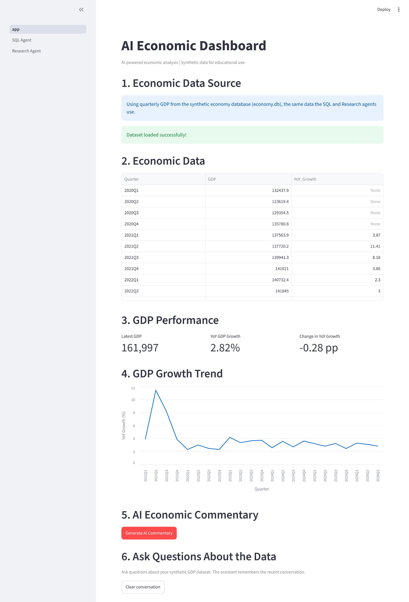

# AI Economic Dashboard

A Streamlit app that analyses quarterly economic data and lets you ask questions about it in plain English. Three LLM agents answer by calling tools, so every number comes from pandas or SQL and every explanation comes from a report passage, never from the model itself.

> **Note:** all data is synthetic and for educational use.



## Features

- **One source of truth:** the dashboard, the chat and all three agents read the same SQLite database, so every page reports the same figures. A test checks that the dashboard's growth matches the SQL view.
- **Data validation:** checks the GDP data for missing quarters, duplicates, non-positive values and too little history.
- **GDP metrics and chart:** latest GDP, year-on-year (YoY) growth, change in growth, and a growth trend chart.
- **AI commentary:** generates a short economic commentary and key observation. The app checks that the model's quarter and growth figures match the calculated ones, and rejects the output if they don't.
- **Chat with your data:** an agent that answers questions using tool calling.
  - Remembers the recent conversation, so follow-ups like "how does 2026Q2 compare with that average?" work.
  - Chains several tool calls for multi-part questions.
  - Declines to forecast or invent causes that the data can't support.
  - Shows a "Tools used" panel under each answer, so you can see exactly what it called.
  - Stops after a fixed number of tool rounds and gives a best-effort answer instead of looping.
- **SQL agent** (`pages/1_SQL_Agent.py`): text-to-SQL over a 27-quarter SQLite database (2020Q1 to 2026Q3) with output by sector. Queries are safe in layers: SELECT/WITH only, a read-only connection, a SQLite authorizer allowlist, a 2-second timeout and a 50-row cap.
- **Research agent** (`pages/2_Research_Agent.py`): combines the SQL tool with search over a set of synthetic economic reports (RAG with ChromaDB). It takes numbers from the database and explanations from the reports, and cites the reports it used.
  - A source check verifies that every cited report was actually retrieved, every quotation of six or more words matches retrieved text, and every percentage appears in an SQL result or a retrieved passage.
  - If the check fails, the agent retries once with the problems listed. If it fails again, it refuses rather than show an unverified answer.
- **REST API** (`api.py`): FastAPI service exposing all three agents plus a metrics endpoint, with request validation and clear HTTP errors. Ships as a Docker image.

## How it works

```
User question
     |
     v
  agent_core.py  --- conversation memory + system rules
     |
     |  1. LLM picks a tool           (get_yoy_growth, run_sql_query, search_reports, ...)
     |  2. Python runs it             (pandas, SQLite or ChromaDB)
     |  3. Result goes back to the LLM
     |  4. Repeat until it can answer
     v
 Final answer + tool trace
```

All three agents share this loop (`agent_core.run_tool_agent`) and differ only in their system prompt and tools. The model never calculates anything itself. It only chooses which function to call and explains the result. Tools return `{"error": ...}` instead of raising, so the model can read the error and try again.

| Agent | Data | Tools |
|---|---|---|
| Dashboard agent (`agent.py`) | `economy.db` GDP, loaded into pandas | pandas functions below |
| SQL agent (`sql_agent.py`) | `economy.db`, 27 quarters | `run_sql_query` |
| Research agent (`research_agent.py`) | `economy.db` + `reports/` | `run_sql_query`, `search_reports` |

### Dashboard agent tools

| Tool | What it does |
|---|---|
| `list_quarters` | Lists the quarters in the dataset |
| `get_gdp` | GDP level for one quarter |
| `get_yoy_growth` | YoY growth for one quarter |
| `get_gdp_series` | GDP and YoY growth for every quarter |
| `compare_quarters` | % change in GDP level between two quarters |
| `average_yoy_growth` | Average YoY growth over a range of quarters |
| `get_extreme_growth` | Quarter with the highest or lowest YoY growth |

## Project structure

```
app.py                  Streamlit dashboard and chat (main page)
api.py                  FastAPI REST API for the agents and metrics
Dockerfile              Container image for the API
pages/1_SQL_Agent.py    SQL agent page
pages/2_Research_Agent.py  Research agent page
agent_core.py           Shared agent loop: memory, multi-step tool calling, trace
agent.py                Dashboard agent (prompt + pandas tools)
analyst_tools.py        Pandas tool functions and their schemas
sql_agent.py            SQL agent (prompt, schema description, tool schema)
sql_tools.py            Safe read-only run_sql_query
research_agent.py       Research agent with source check and retry
rag_tools.py            Report chunking and search_reports (ChromaDB)
grounding.py            Checks citations, quotations and percentages against tool results
economic_analyst.py     Data loading, validation, growth stats, AI commentary
ai_config.py            LLM client and model settings
build_database.py       Generates economy.db (fixed seed)
make_reports.py         Generates reports/*.md
build_index.py          Builds the ChromaDB index in chroma_db/
test_*.py               Offline tests (no API calls)
try_*.py                Manual end-to-end checks against the live API
archives/               Earlier learning exercises
```

## Setup

Requires Python 3 (developed on 3.14) and an API key from [Cerebras](https://cloud.cerebras.ai).

```bash
python -m venv .venv
source .venv/bin/activate
pip install -r requirements.txt

# Generate the data (economy.db is committed; chroma_db/ is not)
python build_database.py    # -> economy.db
python make_reports.py      # -> reports/*.md
python build_index.py       # -> chroma_db/

export CEREBRAS_API_KEY="your-key-here"
streamlit run app.py
```

The SQL and Research agents appear as extra pages in the Streamlit sidebar. The Research agent needs `chroma_db/`, so run `build_index.py` first. Rebuild the index whenever the reports change. The reports' figures must match the database, so if you change `build_database.py`, update `make_reports.py` too.

The key is read from the environment and is never stored in the repo. The LLM client uses an OpenAI-compatible API, so you can switch providers by editing `ai_config.py`.

## REST API

`api.py` exposes the same agents over HTTP, so other programs can use them.

| Method | Path | What it does | Needs API key |
|---|---|---|---|
| GET | `/health` | Liveness check and which data files exist | No |
| GET | `/metrics` | Latest GDP, YoY growth and change in growth | No |
| POST | `/ask/dashboard` | Dashboard agent | Yes |
| POST | `/ask/sql` | SQL agent | Yes |
| POST | `/ask/research` | Research agent with source checks | Yes |

The `/ask` endpoints take `{"question": "...", "history": [...]}` and return `{"answer": "...", "trace": [...]}`, where `trace` lists every tool call. Questions are limited to 1,000 characters and history accepts only `user` and `assistant` roles, so a caller cannot inject a system message. A missing API key returns 503; an agent failure returns 502 without leaking internal details.

Run it locally:

```bash
uvicorn api:app --reload
# Interactive docs: http://127.0.0.1:8000/docs
curl -X POST http://127.0.0.1:8000/ask/sql \
  -H "Content-Type: application/json" \
  -d '{"question": "Which sector grew fastest since 2020Q1?"}'
```

### Docker

The image installs the dependencies, builds the report index at build time (so the embedding model is baked in), and runs as a non-root user with a health check.

```bash
docker build -t economic-analyst-api .
docker run -p 8000:8000 -e CEREBRAS_API_KEY="your-key-here" economic-analyst-api
```

## Deploying the dashboard

The Streamlit app can be deployed free on [Streamlit Community Cloud](https://streamlit.io/cloud):

1. Sign in with GitHub and choose **Create app**, then this repository, branch `main` and main file `app.py`.
2. Under **Advanced settings**, pick Python 3.13 and add the secret `CEREBRAS_API_KEY = "your-key-here"`. Top-level secrets are available as environment variables, which is where `ai_config.py` reads the key.
3. Deploy. The Research agent page builds the report index on its first run, because `chroma_db/` is not committed.

Anyone with the link can use your API quota, so set a spending limit with your LLM provider.

## Example questions

- What was the average YoY growth from 2026Q1 to 2026Q3, and is the latest quarter above or below it?
- Which quarter had the weakest growth?
- Compare GDP levels in 2026Q1 and 2026Q3.
- *Will growth improve next quarter?* The agent declines, because the tools only describe historical data.
- SQL agent: Which sector grew fastest between 2020Q1 and 2026Q3?
- Research agent: Why did GDP fall in 2020Q2, and by how much?

## Tests

```bash
pytest -q
```

The tests run without an API key. They cover the pandas tools, the SQL safety layers, report chunking and search, the source check, the research agent's retry and refusal, the REST API, and the shared agent loop (using a fake LLM client). One test checks that the figures in the reports match the database.

The `try_*.py` scripts call the live API and are named so pytest skips them. Run them directly, for example `python try_research_agent.py`.

## Limitations

- The reports are short and fictional, so the Research agent can only explain events they cover. It says so when they don't.
- Conversation memory keeps the final answers, not the raw tool results, so an earlier mistake could carry into later turns.
- There is no forecasting, by design.

## Roadmap

- [x] LLM APIs and structured outputs
- [x] AI-powered data analysis with pandas and Streamlit
- [x] Function calling and tools
- [x] Conversational agent with memory
- [x] SQL-powered agent (SQLite, safe text-to-SQL)
- [x] RAG over economic reports (embeddings, ChromaDB)
- [x] Agent evaluation and regression tests
- [ ] Power BI integration
- [x] Deployment (FastAPI, Docker)
